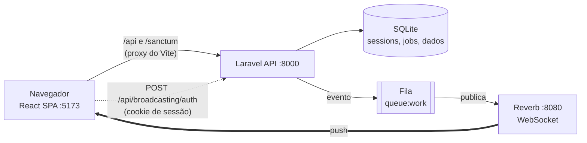

# Contatos — Laravel + React + Bootstrap

Aplicação web com dois perfis (**administrador** e **operador**), login seguro, **aprovação de cadastro em tempo real**, cadastro de contatos com **notificação em tempo real** ao administrador, listagens **paginadas no backend** e **dashboard ao vivo**.

Desenvolvida como teste técnico. Análise de requisitos, diagramas UML, decisões (prós e contras), segurança e roadmap estão em **[docs/ARQUITETURA.md](docs/ARQUITETURA.md)**.

---

## Sumário

1. [Funcionalidades](#1-funcionalidades)
2. [Stack e arquitetura](#2-stack-e-arquitetura)
3. [Pré-requisitos](#3-pré-requisitos)
4. [Instalação](#4-instalação)
5. [Executando](#5-executando)
6. [Roteiro de demonstração](#6-roteiro-de-demonstração)
7. [API](#7-api)
8. [Segurança](#8-segurança)
9. [Testes](#9-testes)
10. [Operação: logs e banco de dados](#10-operação-logs-e-banco-de-dados)
11. [Problemas comuns](#11-problemas-comuns)
12. [Decisões, limitações e próximos passos](#12-decisões-limitações-e-próximos-passos)
13. [Estrutura do projeto](#13-estrutura-do-projeto)

---

## 1. Funcionalidades

| Perfil | O que pode fazer |
|---|---|
| **Visitante** | Entrar. **Solicitar acesso** pela tela de login e aguardar a resposta numa tela que **muda sozinha** (WebSocket), sem atualizar a página. |
| **Operador** | Cadastrar contatos. Listar os **próprios** contatos (paginado, com busca). Excluir os **próprios** contatos. |
| **Administrador** | Receber **notificações em tempo real** (sino + aviso na tela) a cada contato cadastrado ou excluído e a cada solicitação de acesso. Aprovar ou rejeitar solicitações. Criar, desativar e reativar usuários. Listar **todos** os contatos (a lista se atualiza ao vivo) e excluir qualquer um. Ver o **dashboard** e o **feed de atividade** (auditoria). |

**Dashboard (admin):** total de contatos, contatos hoje e nos últimos 7 dias, operadores ativos, solicitações pendentes, contatos por dia (14 dias), por UF e por operador. Atualiza em tempo real a cada evento, com uma atualização de segurança a cada 60 s.

**Paginação:** feita no banco (`LIMIT/OFFSET`). A tela pede `GET /api/contacts?page=N` e o servidor devolve só aquela página (20 itens por padrão, máximo de 50). O seeder cria 40 contatos para exibir duas páginas.

---

## 2. Stack e arquitetura

| Camada | Tecnologia |
|---|---|
| Backend | PHP ≥ 8.3, **Laravel 13**, Laravel Sanctum 4 (SPA, sessão por cookie), **Laravel Reverb** (WebSocket), fila no banco |
| Banco | SQLite (desenvolvimento). Em produção: PostgreSQL ou MySQL |
| Frontend | **React 18** + Vite 5 (JavaScript), **Bootstrap 5**, React Router, axios, Laravel Echo + pusher-js |



O navegador só conversa com `localhost:5173`. O Vite repassa `/api` e `/sanctum` para a API, então o cookie de sessão e o CSRF funcionam sem CORS e **nenhum token fica em `localStorage`**.

**Canais de tempo real**

| Canal | Quem assina | Conteúdo |
|---|---|---|
| `private-admin` | Somente administradores ativos (autorizado no servidor) | Contato criado/excluído, nova solicitação. Sem e-mail ou telefone no payload |
| `registration.{código}` | O solicitante (ainda sem conta) | Apenas o status: `approved` ou `rejected` |

---

## 3. Pré-requisitos

- **PHP 8.3 ou superior** com as extensões `pdo_sqlite`, `sqlite3`, `mbstring`, `openssl`, `fileinfo` e `curl`
- **Composer 2**
- **Node.js 18 ou superior** e npm
- Git

> **Windows:** se aparecer `could not find driver`, abra o `php.ini` (`php --ini` mostra o caminho) e remova o `;` das linhas `extension=pdo_sqlite` e `extension=sqlite3`.

---

## 4. Instalação

### 4.1 Clonar

```bash
git clone <https://github.com/LipeGrandotto/Sistema_Login_Contatos_TempoReal.git> contatos-app
cd contatos-app
```

### 4.2 Backend

```bash
cd backend
composer install
```

Crie o arquivo `.env` a partir do modelo e gere a chave da aplicação:

```powershell
# Windows (PowerShell)
copy .env.example .env
php artisan key:generate
```
```bash
# Linux / macOS
cp .env.example .env
php artisan key:generate
```

Abra o `backend/.env` e preencha os valores em branco:

| Variável | O que colocar |
|---|---|
| `REVERB_APP_KEY` | Texto aleatório. Gere com `php -r "echo bin2hex(random_bytes(10));"` |
| `REVERB_APP_SECRET` | Outro texto aleatório (mesmo comando) |
| `ADMIN_PASSWORD` | Senha do administrador |
| `OPERATOR_PASSWORD` | Senha do operador de demonstração |

As senhas precisam ter **10 ou mais caracteres, com maiúscula, minúscula, número e símbolo** (ex.: `Minh@Senha2026`). Já vêm configuradas no modelo: `SANCTUM_STATEFUL_DOMAINS`, `BROADCAST_CONNECTION=reverb`, `QUEUE_CONNECTION=database`, `ADMIN_EMAIL=admin@example.com` e `OPERATOR_EMAIL=operador@example.com`.

Crie o banco e popule os dados:

```powershell
# Windows (PowerShell)
New-Item database\database.sqlite -ItemType File -Force
php artisan migrate --seed
```
```bash
# Linux / macOS
touch database/database.sqlite
php artisan migrate --seed
```

O seeder cria o administrador, um operador de demonstração e **40 contatos**.

### 4.3 Frontend

```bash
cd ../frontend
npm install
```

Crie o `frontend/.env` e coloque nele **o mesmo valor** de `REVERB_APP_KEY` do backend:

```powershell
copy .env.example .env      # Windows
```
```bash
cp .env.example .env        # Linux / macOS
```

```
VITE_REVERB_APP_KEY=<mesmo valor do REVERB_APP_KEY do backend>
VITE_REVERB_HOST=localhost
VITE_REVERB_PORT=8080
VITE_REVERB_SCHEME=http
```

---

## 5. Executando

São **quatro processos** (todos precisam estar ativos para o tempo real funcionar):

| Processo | Comando (na pasta indicada) | Porta |
|---|---|---|
| API | `backend`: `php artisan serve --host=127.0.0.1 --port=8000` | 8000 |
| WebSocket | `backend`: `php artisan reverb:start --host=0.0.0.0 --port=8080` | 8080 |
| Fila | `backend`: `php artisan queue:work --tries=3 --sleep=1` | – |
| Frontend | `frontend`: `npm run dev` | 5173 |

**Atalhos** (na raiz do projeto):

```powershell
.\dev.bat           # Windows: abre os 4 processos e o navegador
```
```bash
./scripts/dev.sh    # Linux / macOS
```

Acesse **http://localhost:5173** (use `localhost`, não `127.0.0.1`, para casar com o domínio configurado no Sanctum).

**Credenciais:** administrador `admin@example.com` e operador `operador@example.com`, com as senhas que você definiu no `backend/.env`.

> Sem o processo da **fila**, nenhuma notificação em tempo real é entregue. Sem o **Reverb**, o navegador não recebe nada.

---

## 6. Roteiro de demonstração

Use duas janelas: uma **anônima** e uma normal.

1. **Janela anônima:** abra o app, vá em *Solicitar acesso*, preencha com um e-mail novo e uma senha forte. Aparece "Aguardando aprovação…". **Não atualize a página.**
2. **Janela normal:** entre como **administrador**. O sino 🔔 acende com a nova solicitação.
3. Abra **Solicitações**, aba *Pendente*, e clique em **Aprovar**.
4. **Janela anônima:** a tela muda sozinha para "Aprovado". Clique em *Ir para o login* e entre com a senha escolhida.
5. Como **operador**, cadastre um contato. Na janela do administrador surge o aviso e o **dashboard**, a lista de **contatos** e o feed de **atividade** se atualizam sozinhos.
6. Em *Contatos*, navegue entre as **2 páginas** (cada clique é uma consulta `?page=N` ao servidor). Teste a busca e o botão **Excluir**.
7. Como operador, tente abrir `/dashboard`: você é redirecionado, e a API devolve **403** em `/api/admin/*`.

---

## 7. API

Base: `/api`. Respostas em JSON. Rotas autenticadas usam o cookie de sessão (com o cabeçalho `X-XSRF-TOKEN`).

| Método e rota | Acesso | Descrição |
|---|---|---|
| `POST /login` | Público (limite 5/min por e-mail+IP) | Login |
| `POST /registration-requests` | Público (limite 5/hora por IP) | Solicita acesso; devolve `{channel}` |
| `POST /logout` · `GET /me` | Autenticado | Encerra sessão · dados do usuário |
| `GET /contacts?page=&per_page=&q=` | Autenticado | Lista paginada (operador vê só os próprios; admin vê todos) |
| `POST /contacts` | Autenticado | Cadastra contato e notifica os admins |
| `DELETE /contacts/{id}` | Autenticado | Operador exclui só os próprios; admin exclui qualquer um |
| `GET /admin/dashboard` | Admin | Métricas do dashboard |
| `GET /admin/activity` | Admin | Feed de auditoria (paginado) |
| `GET /admin/registration-requests?status=` | Admin | Solicitações (paginado) |
| `POST /admin/registration-requests/{id}/approve` · `/reject` | Admin | Analisa a solicitação |
| `GET /admin/users` · `POST /admin/users` | Admin | Lista e cria usuários |
| `PATCH /admin/users/{id}/active` | Admin | Ativa/desativa (derruba as sessões) |
| `POST /broadcasting/auth` | Autenticado | Autoriza canais privados do WebSocket |

---

## 8. Segurança

| Ameaça | Controle |
|---|---|
| Força bruta no login | Limite por e-mail+IP e por IP; mensagem genérica "Credenciais inválidas" |
| Roubo de sessão (XSS) | Sessão em cookie **HttpOnly + SameSite=Lax**; nenhum token em `localStorage`; React escapa a saída |
| CSRF | Sanctum SPA: `XSRF-TOKEN` → `X-XSRF-TOKEN`, só para origens em `SANCTUM_STATEFUL_DOMAINS` |
| Fixação de sessão | `session()->regenerate()` no login; `invalidate()` no logout |
| Senhas | Hash do Laravel (**bcrypt**, custo 12) com política forte (10+, maiúscula, minúscula, número, símbolo). Argon2id é opcional: defina `HASH_DRIVER=argon2id` **antes** de rodar o seed |
| Escalonamento de privilégio | `role`, `is_active` e `created_by` fora do `$fillable`; rotas `/admin` com `role:admin`; canal `private-admin` autorizado no servidor |
| Enumeração de usuários | O cadastro responde igual exista o e-mail ou não; o login usa mensagem genérica |
| Usuário desativado | Não loga e as sessões abertas são apagadas na hora |
| Injeção | Eloquent com bindings; `LIKE` escapado; validação estrita (UF em lista, regex de telefone, tamanhos máximos) |
| Abuso de API | `throttle:api` 120/min; `per_page` limitado a 50 |
| Vazamento por WebSocket | Payloads mínimos, sem e-mail nem telefone; o canal do solicitante só leva o status |
| Concorrência | Aprovação em transação com `lockForUpdate`; segunda análise recebe 409 |
| Cabeçalhos | `X-Content-Type-Options`, `X-Frame-Options`, `Referrer-Policy`, CSP restritiva e `no-store` na API, HSTS em HTTPS |
| Auditoria | Login, logout, solicitações, aprovações, usuários e contatos, com IP (`activity_logs`) |

Riscos conhecidos e o que seria feito em produção estão em [docs/ARQUITETURA.md](docs/ARQUITETURA.md).

---

## 9. Testes

```bash
cd backend
php artisan test
```

Cobrem: acesso anônimo (401), operador em rota de admin (403), login genérico e usuário inativo, criação de contato disparando o evento, validação de UF, **paginação e escopo por perfil**, anti-enumeração, **aprovação completa** (hash guardado, usuário criado, dupla análise bloqueada), senha fraca e **exclusão de contatos** por perfil.

---

## 10. Operação: logs e banco de dados

**Logs**

| Onde | Conteúdo |
|---|---|
| `backend/storage/logs/` | Erros do Laravel (um arquivo por dia com `LOG_STACK=daily`, mantendo `LOG_DAILY_DAYS` dias) |
| Janelas dos 4 processos | Requisições da API, Reverb e jobs da fila |
| Tela **Atividade** (admin) | Auditoria funcional |

```powershell
# Acompanhar em tempo real (PowerShell, dentro de backend)
Get-Content .\storage\logs\laravel-*.log -Tail 50 -Wait
# Apagar logs com mais de 7 dias
Get-ChildItem .\storage\logs\*.log | Where-Object LastWriteTime -lt (Get-Date).AddDays(-7) | Remove-Item
```

**Banco de dados:** arquivo `backend/database/database.sqlite`. Tabelas: `users`, `contacts`, `registration_requests`, `activity_logs`, `sessions`, `cache`, `jobs`, `failed_jobs`.

```bash
php artisan db:show                 # visão geral
php artisan db:table contacts       # colunas e índices
php artisan queue:flush             # apaga jobs que falharam
php artisan migrate:fresh --seed    # ATENÇÃO: apaga todos os dados e recria os de demonstração
```

---

## 11. Problemas comuns

| Sintoma | Causa e solução |
|---|---|
| Login falha com 419 ou `Session store not set on request` | `SANCTUM_STATEFUL_DOMAINS` sem `localhost:5173`. Confira o `.env`, reinicie a API e acesse por `http://localhost:5173` |
| `could not find driver` | Habilite `pdo_sqlite` e `sqlite3` no `php.ini` |
| `Defina ADMIN_PASSWORD no .env` ao rodar o seed | Preencha `ADMIN_PASSWORD` no `backend/.env` |
| Sem notificações em tempo real | Confirme os processos `reverb:start` e `queue:work`; `BROADCAST_CONNECTION=reverb`; `VITE_REVERB_APP_KEY` do frontend igual ao `REVERB_APP_KEY` do backend (reinicie o Vite depois de alterar) |
| `database is locked` (SQLite) | Ocorre quando API e fila gravam ao mesmo tempo. Em `backend/config/database.php`, na conexão `sqlite`, use `'busy_timeout' => 5000`, `'journal_mode' => 'WAL'` e `'synchronous' => 'NORMAL'`. Não deixe um visualizador de SQLite aberto em modo de escrita |
| Tela em branco ou erro de rede | Veja o console (F12) e a aba Rede; confirme que a API responde em `http://127.0.0.1:8000/up` |
| Trocou `HASH_DRIVER` e ninguém mais entra | Hashes antigos não servem ao novo algoritmo: rode `php artisan migrate:fresh --seed` |

---

## 12. Decisões, limitações e próximos passos

**Decisões principais** (detalhes e prós/contras em [docs/ARQUITETURA.md](docs/ARQUITETURA.md))

- **Sessão em cookie (Sanctum) em vez de JWT:** o JavaScript não lê a sessão, e a revogação é imediata. Custo: exige mesma origem e armazenamento de sessão compartilhado ao escalar.
- **Reverb (WebSocket) em vez de polling:** latência baixa e sem custo por mensagem. Custo: mais um processo para operar.
- **Canal público com código aleatório para o solicitante:** ele ainda não tem sessão. Só o status trafega.
- **Operador vê e exclui apenas os próprios contatos; admin vê e exclui todos.** Para lista compartilhada, basta remover o filtro `created_by` em `ContactController@index`.
- **Exclusão definitiva (sem lixeira):** combina com o direito de apagar dados da LGPD. Para recuperação, o caminho é *soft delete*.

**Limitações conhecidas**

- Sem MFA, verificação de e-mail, edição de contatos e testes automatizados do frontend.
- SQLite e fila no banco servem para demonstração; sob carga, o SQLite pode bloquear gravações concorrentes.
- `allowed_origins` do Reverb aceita qualquer origem (restringir em produção).
- O tempo de resposta do login pode, em tese, revelar se um e-mail existe.
- Docker não está incluído.

**Próximos passos**

PostgreSQL ou MySQL + Redis (sessão, cache e fila) e Horizon · MFA para administradores · paginação por cursor e busca indexada · agregação do dashboard por job agendado · CI com testes, `composer audit` e `npm audit` · testes E2E (Playwright) do fluxo de aprovação em tempo real · Docker.

---

## 13. Estrutura do projeto

```
contatos-app/
├── dev.bat                      # Windows: sobe API, Reverb, fila e Vite
├── scripts/dev.sh               # Linux/macOS: idem
├── docs/ARQUITETURA.md          # requisitos, UML, segurança, trade-offs
├── backend/                     # Laravel
│   ├── bootstrap/app.php        # middlewares, sessão stateful, broadcasting
│   ├── routes/                  # api.php (endpoints) · channels.php (canais)
│   ├── app/Http/Controllers/    # Auth, Contact, RegistrationRequest, Admin/*
│   ├── app/Http/Middleware/     # EnsureRole, SecurityHeaders
│   ├── app/Http/Requests/       # validação de entrada
│   ├── app/Events/              # ContactCreated, ContactDeleted, Registration*
│   ├── app/Models/              # User, Contact, RegistrationRequest, ActivityLog
│   ├── app/Services/            # ActivityLogger (auditoria)
│   ├── database/                # migrations, factory, seeder
│   └── tests/Feature/           # testes de feature
└── frontend/src/
    ├── api.js · echo.js         # axios (cookie + CSRF) · WebSocket
    ├── auth/                    # AuthContext, RequireAuth
    ├── components/              # Layout, RealtimeContext, Pagination
    └── pages/                   # Login, Contacts, Dashboard, Requests, Users, Activity
```
