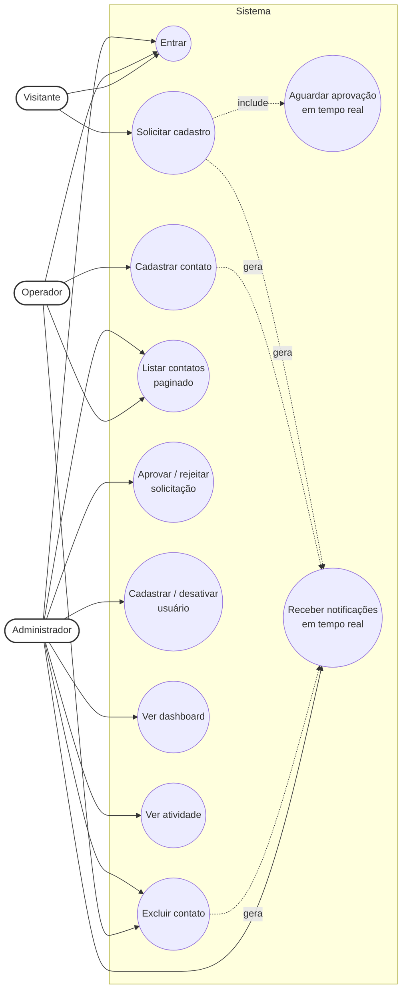
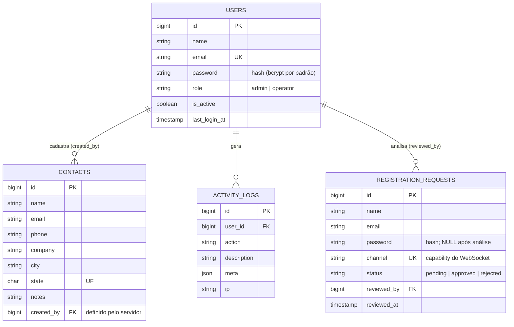
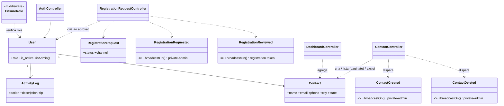
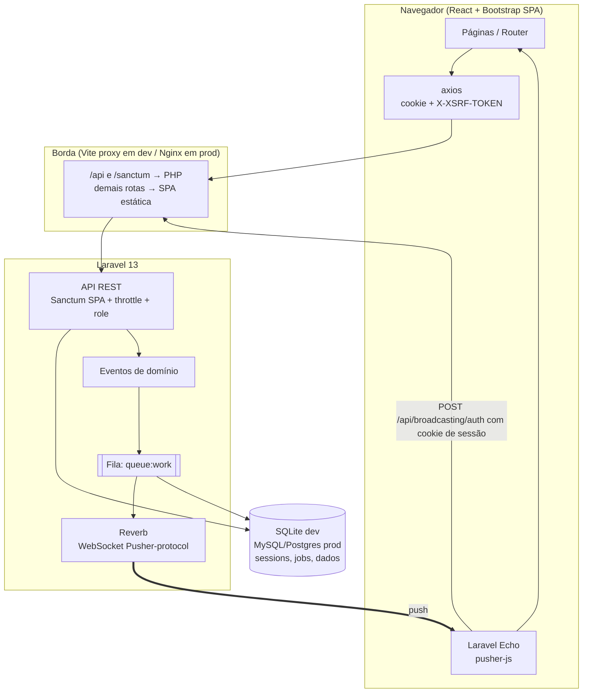
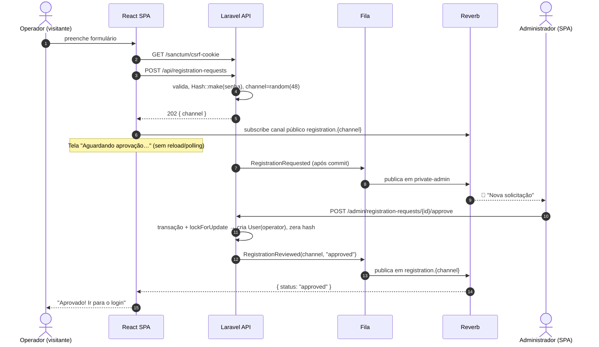
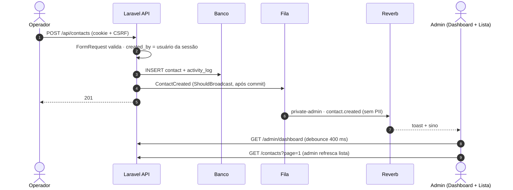
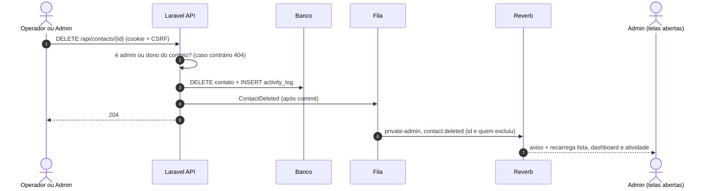

# Análise de Requisitos e System Design

> Contatos é uma aplicação full stack com dois perfis. O operador solicita acesso e acompanha a aprovação em tempo real, sem recarregar a página, cadastra contatos e o administrador é notificado ao vivo, com dashboard e feed de auditoria. O foco está em segurança (sessão HttpOnly, CSRF, rate limit, RBAC no servidor), paginação no backend e decisões de arquitetura documentadas.

> **Alinhado ao código entregue:** PHP 8.3, Laravel 13, Sanctum 4, Reverb, SQLite, React 18 + Vite, execução local (`dev.bat` / `scripts/dev.sh`).

## 1. Entendimento do problema e premissas

| # | Premissa / decisão tomada | Impacto | Alternativa (se o avaliador preferir) |
|---|---|---|---|
| P1 | **Operador vê apenas os contatos que ele cadastrou**; admin vê todos | Menor privilégio / LGPD | Operadores compartilharem a lista: remover o `where created_by` em `ContactController@index` (1 linha) |
| P2 | Solicitação de cadastro aprovada cria usuário com perfil **operador** | Admin não é autoatribuível | Admin escolher o perfil no momento da aprovação |
| P3 | A senha é definida pelo próprio solicitante já no formulário (guardada **apenas como hash**, e descartada após a análise) | Admin nunca vê/define a senha do operador | Admin definir senha temporária + troca obrigatória no 1º login |
| P4 | Resposta do cadastro é **idêntica** para e-mail novo ou já existente | Evita enumeração de usuários | Validar `unique` e mostrar erro (melhor UX, pior segurança) |
| P5 | "Contato" = nome, e-mail, telefone, empresa, cidade, UF, observações. **UF/Cidade/Operador** são as dimensões do dashboard | Dashboard com dimensões úteis | Campos configuráveis (roadmap) |
| P6 | Autenticação por **sessão em cookie HttpOnly** (Sanctum SPA), não JWT | Ver §5 | JWT/OAuth2 se houver clientes mobile/terceiros |
| P7 | **Operador exclui apenas os próprios contatos**; admin exclui qualquer um | Menor privilégio; sem edição indevida de dados alheios | Somente admin exclui; ou exclusão por aprovação |
| P8 | **Exclusão definitiva** (sem lixeira), registrada no feed de atividade | Atende ao direito de apagar dados (LGPD) | *Soft delete* (`deleted_at`) se for preciso recuperar |

**Perguntas que faria ao time de negócio** (e as premissas acima são minha resposta provisória): quantos usuários/contatos simultâneos? Há LGPD/consentimento para os contatos? Operador pode editar? (excluir foi implementado, ver P7) Precisamos de MFA para admins? O contato precisa ser único por e-mail?

## 2. Requisitos

### Funcionais
| ID | Requisito | Status |
|---|---|---|
| RF01 | Tela de login (e-mail + senha) | ✅ |
| RF02 | Operador solicita cadastro na tela de login e **aguarda aprovação em tempo real, sem atualizar a tela** | ✅ WebSocket (canal `registration.{token}`) |
| RF03 | Admin recebe solicitações em tempo real, aprova ou rejeita | ✅ |
| RF04 | Admin cadastra novos usuários (operador/admin) e ativa/desativa | ✅ |
| RF05 | Operador cadastra contatos | ✅ |
| RF06 | Cada contato cadastrado gera **notificação em tempo real** ao admin | ✅ (sino + toast) |
| RF07 | Admin e operador listam contatos; **paginação no backend**; seed com 2 páginas (40 contatos / 20 por página) | ✅ |
| RF08 | Admin analisa o que acontece na aplicação | ✅ Feed de atividade (auditoria) |
| RF09 *(extra)* | Dashboard em tempo real: totais, hoje, 7 dias, por dia, por UF, por operador, pendências | ✅ |
| RF10 | Excluir contato: operador os próprios, admin qualquer um; admins notificados em tempo real | ✅ `DELETE /api/contacts/{id}` + evento `ContactDeleted` |

### Não funcionais
| ID | Requisito | Como é atendido |
|---|---|---|
| RNF01 | Segurança de autenticação | Ver §6 |
| RNF02 | Manutenibilidade | Form Requests, controllers finos, eventos de domínio, testes automatizados, repositório limpo (sem `vendor/`, `node_modules/` e `.env`) |
| RNF03 | Escalabilidade | Stateless exceto sessão (em DB/Redis), broadcast via fila, índices alinhados às queries, paginação em SQL — ver §8 |
| RNF04 | Observabilidade | `activity_logs` (auditoria funcional), logs do Laravel |
| RNF05 | Portabilidade | execução local documentada no README (`dev.bat` / `scripts/dev.sh`); SQLite local, PostgreSQL/MySQL em produção |

## 3. Casos de uso



## 4. Modelo de dados (ER / classes de domínio)





## 5. Arquitetura



### Fluxo 1 — Solicitação de cadastro com espera em tempo real



### Fluxo 2 — Contato cadastrado → notificação ao admin → dashboard



### Fluxo 2b — Exclusão de contato



### Fluxo 3 — Login

```mermaid
sequenceDiagram
    autonumber
    participant SPA
    participant API as Laravel (throttle:login)
    SPA->>API: GET /sanctum/csrf-cookie
    API-->>SPA: Set-Cookie XSRF-TOKEN (legível pelo JS) + laravel_session (HttpOnly)
    SPA->>API: POST /api/login {email, senha} + X-XSRF-TOKEN
    API->>API: rate limit (5/min por e-mail+IP) → Auth::attempt(is_active=true)
    API->>API: session()->regenerate()  # anti fixation
    API-->>SPA: 200 {user} (novo cookie de sessão)
    SPA->>API: demais chamadas com cookie; 401 ⇒ volta ao login
```

## 6. Segurança (foco da avaliação)

| Ameaça (OWASP) | Controle implementado | Onde |
|---|---|---|
| **A07 Falhas de autenticação** — força bruta | `throttle:login`: 5/min por *e-mail+IP* e 20/min por IP; mensagem genérica "Credenciais inválidas" | `AppServiceProvider`, `AuthController` |
| Armazenamento de senha | Hash do Laravel (**bcrypt**, custo 12 por padrão; Argon2id disponível com `HASH_DRIVER=argon2id` definido **antes** do seed); cast `hashed`; nunca logada/retornada; hash da solicitação é **zerado** após análise | `.env`, `User`, `RegistrationRequestController` |
| Política de senha | mín. 10, maiúscula, minúscula, número, símbolo (centralizada em `Password::defaults`) | `AppServiceProvider` |
| **Roubo de sessão / XSS** | Sessão em cookie **HttpOnly + SameSite=Lax** (+ `Secure` em produção). **Nenhum token em localStorage**; React escapa saída por padrão | `.env`, SPA |
| Session fixation | `session()->regenerate()` no login; `invalidate()` + `regenerateToken()` no logout | `AuthController` |
| **CSRF** | Sanctum SPA: cookie `XSRF-TOKEN` → header `X-XSRF-TOKEN`; só origens em `SANCTUM_STATEFUL_DOMAINS` | `bootstrap/app.php` |
| **A01 Broken Access Control** | Middleware `role:admin` no grupo `/admin`; operador filtrado por `created_by` (e só exclui os próprios, com 404 para os demais); `role`/`is_active`/`created_by` **fora do `$fillable`** (sem mass-assignment); canal WebSocket `private-admin` autorizado no servidor | `routes/api.php`, models, `channels.php` |
| Usuário desativado | `is_active` na query do login **e** sessões apagadas imediatamente ao desativar | `AuthController`, `UserController` |
| Enumeração de usuários | Cadastro responde 202 idêntico (existe ou não); login com mensagem genérica | `RegistrationRequestController` |
| **A03 Injeção** | Eloquent/Query Builder com bindings; busca com `LIKE` escapado; validação estrita (UF em lista, regex de telefone) | `ContactController`, `StoreContactRequest` |
| Abuso de API / DoS | `throttle:api` 120/min; `per_page` limitado a 50; cadastro 5/hora/IP | `AppServiceProvider`, `ContactController` |
| Vazamento via WebSocket | Eventos carregam **payload mínimo, sem PII** (sem e-mail/telefone); canal público do solicitante tem nome com 286 bits de entropia e leva só `status` | `Events/*` |
| Concorrência | Aprovação em transação com `lockForUpdate` + 409 para dupla análise | `RegistrationRequestController` |
| Headers | `X-Content-Type-Options`, `X-Frame-Options: DENY`, `Referrer-Policy`, CSP restritiva na API, `Cache-Control: no-store`, HSTS em HTTPS | `SecurityHeaders` |
| Auditoria | Login/logout, solicitações, aprovações, criação de usuários, criação e exclusão de contatos, com IP | `activity_logs` |
| Segredos | Credenciais de demo definidas no `.env` (git-ignored); o repositório traz só o `.env.example`, sem valores secretos | `.env`, `.env.example`, `.gitignore` |

### Riscos residuais conhecidos (e o que faria em produção)
1. **Timing de login** pode revelar existência de e-mail (hash só roda se o usuário existe). → hash dummy quando não existir.
2. **Canal público do solicitante** é um *bearer secret*: quem o conhecer só recebe `approved/rejected`, mas isso é um trade-off consciente. → alternativa: SSE com token assinado e expiração, ou e-mail de confirmação.
3. **Sem MFA** nem verificação de e-mail. → TOTP (Fortify) obrigatório para admin; e-mail de verificação.
4. **Reverb `allowed_origins`** está aberto em dev. → restringir ao domínio do app.
5. **CSP do frontend** deve ser entregue pelo Nginx/CDN (`script-src 'self'; connect-src 'self' wss://…`).
6. Sem política de expiração de senha / bloqueio de conta persistente (hoje é só rate limit temporal).
7. **LGPD:** a exclusão de contatos é definitiva (atende ao direito de apagar), mas faltam anonimização, exportação e retenção do `activity_logs`, que guarda o nome do contato excluído. → registrar só o id.
8. **SQLite com escrita concorrente** (API + worker da fila) pode gerar `database is locked`. → `busy_timeout` e WAL em desenvolvimento; PostgreSQL/MySQL em produção.
9. O **seeder não aplica a política de senha** (só as telas aplicam). → validar `ADMIN_PASSWORD` no seeder e exigir troca no primeiro acesso.

## 7. Decisões técnicas — prós e contras

### 7.1 Stack: Laravel + React + Bootstrap (exigida) e como foi usada
| Escolha | Prós | Contras |
|---|---|---|
| **Laravel 13 (API)** | Segurança *batteries-included* (hash, CSRF, throttle, validação, policies), Sanctum, broadcasting/Reverb, filas, testes; ecossistema maduro | Mais "pesado" que micro-frameworks; PHP-FPM tem custo por requisição; WebSocket exige processo extra |
| **React SPA (JS) + Vite** | UI reativa ideal para tempo real; separação clara front/back; escala o front em CDN | Duas bases de código/deploy; SEO irrelevante aqui; superfície XSS no cliente (mitigada: sem token em storage) |
| **Bootstrap 5** (sem jQuery, sem JS do BS) | Entrega rápida, acessível, componentes prontos; poucos deps | Visual "genérico"; gráficos feitos com barras CSS (suficiente; Chart.js seria o próximo passo) |

### 7.2 Autenticação: sessão em cookie (Sanctum SPA) vs. token (JWT/Sanctum token)
| | Cookie de sessão + CSRF (**escolhido**) | JWT / token em storage |
|---|---|---|
| Prós | HttpOnly (JS não lê → XSS não rouba sessão); **revogação imediata** (apaga linha em `sessions`); regenerate no login; nativo no Laravel | Stateless puro; bom para mobile/terceiros; fácil escalar horizontalmente sem store |
| Contras | Exige mesma *site* (proxy/domínio) e CSRF; sessão precisa de store compartilhado ao escalar (Redis/DB) | Se ficar em localStorage, XSS = roubo; revogação é difícil (blacklist/expiração curta + refresh) |

Como o cliente é só a SPA própria e segurança é critério principal, a sessão vence. Se surgir app mobile, adiciona-se token Sanctum **sem mexer** nas regras de autorização.

### 7.3 Tempo real: Reverb (WebSocket) vs. Pusher/Ably vs. SSE vs. polling
| | Prós | Contras |
|---|---|---|
| **Laravel Reverb** (escolhido) | Open-source, mesmo protocolo do Pusher (Echo nativo), sem custo por mensagem, dados ficam na casa, escala com Redis | Mais um processo para operar/monitorar |
| Pusher/Ably (SaaS) | Zero operação, SLA | Custo recorrente; dados de terceiros; dependência externa |
| SSE | Simples, HTTP puro | Unidirecional; sem integração com canais privados do Laravel; limite de conexões por domínio em HTTP/1.1 |
| Polling | Trivial | Latência e carga ∝ usuários; **o enunciado proíbe refresh**, polling escondido seria contornar o objetivo |

O dashboard também tem um *poll* de 60 s apenas como **rede de segurança** e ressincroniza ao reconectar o WebSocket.

### 7.4 Banco de dados
SQLite (dev: zero setup, qualquer avaliador roda) → **MySQL/PostgreSQL em produção** (concorrência de escrita, réplicas, backups). Nada no código é específico de SQLite (`DATE()`, `COUNT`, `GROUP BY` são portáveis).

**Limitação observada na prática:** com a API e o worker da fila gravando ao mesmo tempo, o SQLite padrão (`busy_timeout` nulo) pode falhar com `database is locked`. Mitigação em desenvolvimento, em `config/database.php` (conexão `sqlite`): `'busy_timeout' => 5000`, `'journal_mode' => 'WAL'`, `'synchronous' => 'NORMAL'`. Em produção, o correto é PostgreSQL ou MySQL.

### 7.5 Canal do solicitante: público com token vs. privado autenticado
O solicitante **ainda não existe** → não há sessão para autorizar canal privado. Alternativas: (a) polling (proibido pelo escopo), (b) canal público com *capability* aleatória (**escolhido**, payload só com status), (c) SSE com JWT assinado. Escolhi (b) pela simplicidade e porque o vazamento do token só revela um status.

### 7.6 Low-code/No-code
Descartado: o requisito de segurança ("a forma de fazer o login é critério") pede controle fino sobre sessão, rate limit, autorização de canais e auditoria — pontos em que plataformas low-code costumam ser caixas-pretas. Teria *time-to-market* melhor para um CRUD simples.

## 8. Escalabilidade e evolução (visão de produto)

| Gargalo provável | Evolução |
|---|---|
| Sessões/cache/fila em DB | **Redis** para `SESSION_DRIVER`, `CACHE_STORE`, `QUEUE_CONNECTION` (+ Horizon) |
| Múltiplos servidores WebSocket | Reverb com `REVERB_SCALING_ENABLED=true` (Redis pub/sub) atrás de balanceador com *sticky* não necessário |
| Listagem com milhões de contatos | `OFFSET` degrada em páginas profundas → **keyset pagination** (`cursorPaginate`) + busca em índice FULLTEXT/Meilisearch |
| Dashboard pesado | Agregar via job agendado (`schedule`) em tabela de métricas diárias; cache de 10–30 s; WebSocket só avisa "recarregue" |
| `activity_logs` cresce rápido | Particionamento por mês + retenção; envio a ELK/Loki |
| Deploy | Docker + CI (lint, `php artisan test`, `npm run build`, Trivy/`composer audit`/`npm audit`), Nginx servindo `dist/` e `/api` → php-fpm, Supervisor/systemd para `queue:work` e `reverb:start` |
| Qualidade | Pint/PHPStan (nível 6+), ESLint, testes E2E (Playwright) do fluxo de aprovação em tempo real |

## 9. Estratégia de testes

`backend/tests/Feature/AppFlowTest.php` (PHPUnit, banco SQLite em memória, `php artisan test`) cobre:

- **Acesso:** 401 para anônimo; 403 para operador em rotas de admin.
- **Login:** mensagem genérica; usuário inativo não entra.
- **Contatos:** criação dispara `ContactCreated`; UF inválida é rejeitada; **paginação** (25 itens em 2 páginas) e escopo por perfil.
- **Exclusão:** operador apaga o próprio e recebe 404 no alheio; admin apaga qualquer um; visitante recebe 401; `ContactDeleted` é disparado.
- **Cadastro:** anti-enumeração; aprovação cria o usuário, guarda o hash (não a senha) e bloqueia a dupla análise; senha fraca é rejeitada.

A última execução local passou sem falhas. **Lacunas:** não há testes automatizados do frontend nem testes do canal de WebSocket; o fluxo de aprovação em tempo real é validado manualmente (roteiro no README). Próximo passo: Playwright com duas sessões de navegador.

## 10. Operação e observabilidade

| Item | Onde |
|---|---|
| Logs da aplicação | `backend/storage/logs/` (um arquivo por dia com `LOG_STACK=daily`, `LOG_DAILY_DAYS=14`) |
| Auditoria funcional | Tabela `activity_logs` e tela "Atividade" do admin |
| Banco (dev) | `backend/database/database.sqlite` |
| Processos | API (8000), Reverb (8080), fila (`queue:work`) e Vite (5173); o tempo real depende de Reverb **e** fila |
| Jobs com falha | `php artisan queue:flush` limpa a tabela `failed_jobs` |

## 11. Problemas encontrados durante o desenvolvimento e como foram resolvidos

| Sintoma (log) | Causa | Solução |
|---|---|---|
| `could not find driver` | Extensão `pdo_sqlite` desabilitada no `php.ini` (Windows) | Habilitar `pdo_sqlite` e `sqlite3` |
| `Defina ADMIN_PASSWORD no .env` | O seeder exige a variável (nada de senha fixa no código) | Definir `ADMIN_PASSWORD` no `.env` |
| `Trait HasApiTokens not found` e `personal_access_tokens already exists` | Sanctum ainda não instalado e migration executada duas vezes | `composer install` completo e conferir as migrations antes de migrar |
| `Session store not set on request` (login) | `localhost:5173` fora de `SANCTUM_STATEFUL_DOMAINS`, então a requisição não era "stateful" e não tinha sessão | Incluir `localhost:5173,127.0.0.1:5173` no `.env` |
| `database is locked` | API e worker gravando juntos no SQLite sem tempo de espera | `busy_timeout`/WAL em `config/database.php` (ver §7.4) |
